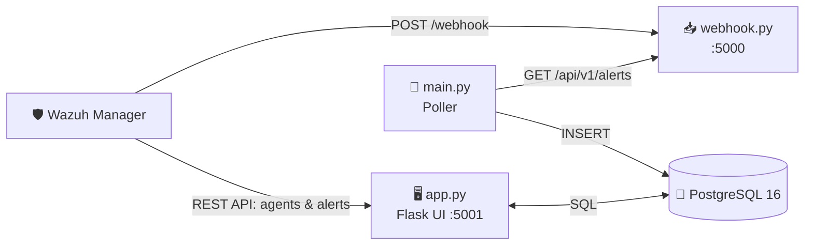
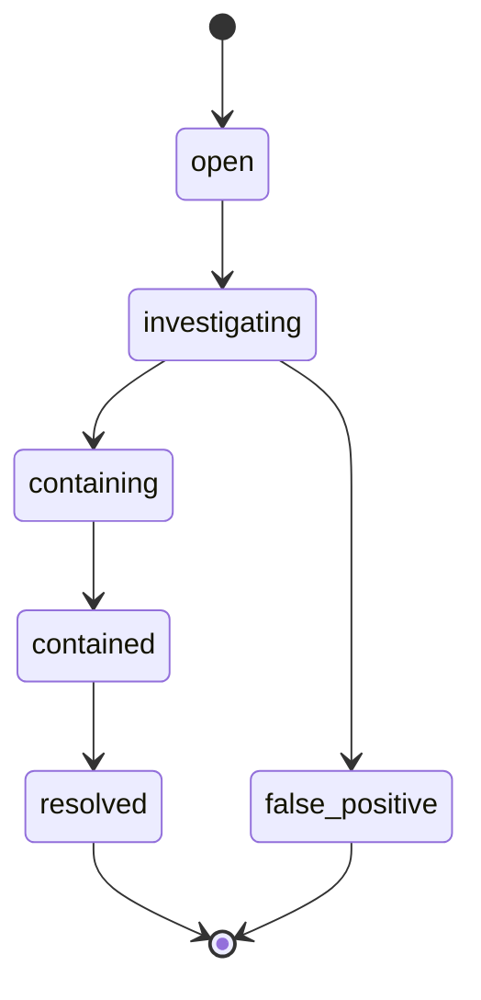

<div align="center">


### 🛡️ A lightweight SOC dashboard & incident-response platform for Wazuh

<p>
  
  
  
  
  
</p>

<p>
  
  
  
  
</p>

[✨ Features](#-features) •
[🏗️ Architecture](#️-architecture) •
[🚀 Quick Start](#-quick-start) •
[⚙️ Configuration](#️-configuration) •
[📡 API](#-api-overview) •
[🤝 Contributing](#-contributing)

</div>

---

## 📖 About

**ZERO** ingests security alerts from [Wazuh](https://wazuh.com/) through a webhook, stores them in PostgreSQL, and serves them in a clean web UI with live alert feeds, platform health, monitored endpoints, and an incident case manager driven by response playbooks.

> 💡 From raw alert to resolved case, all in one place.

---

## ✨ Features

| | Feature | Description |
|---|---|---|
| 📥 | **Webhook Receiver** | Accepts Wazuh alerts and normalises source IP, target user, MITRE technique/tactic and threat type |
| 🔄 | **Alert Poller** | Continuously syncs parsed alerts from the webhook into PostgreSQL |
| 📊 | **SOC Dashboard** | Severity breakdown, daily trend, top agents, top source IPs, category split, recent alerts |
| 🔎 | **Alert Feed** | Filter by severity, category, free-text search and time range |
| 🧠 | **Threat Classification** | Maps alerts into Brute Force, Privilege Escalation, File Integrity and Ransomware using threat type, rule IDs and MITRE ATT&CK families |
| 🖥️ | **Monitored Systems** | Live Wazuh agent inventory: status, OS, department, alerts today, last keep-alive |
| 💓 | **Platform Health** | Checks for Webhook API, UI, PostgreSQL and alert-sync freshness |
| 🗂️ | **Incident Cases** | Case lifecycle tracking with step-by-step response playbooks |
| 🔐 | **Auth & RBAC** | Session login, admin-only routes, password reset and audit log |
| 🐳 | **Dockerised** | Entire stack up with one command |

---

## 🏗️ Architecture



| Service | Entry point | Port | Purpose |
|:---|:---|:---:|:---|
| 🐘 `db` | PostgreSQL 16 | `5432` | Stores alerts, users, cases and audit data (`init.sql`) |
| 📥 `webhook` | `webhook.py` | `5000` | Receives and parses Wazuh alerts |
| 🔄 `poller` | `main.py` | n/a | Syncs alerts from the webhook into PostgreSQL |
| 🖥️ `app` | `app.py` | `5001` | Web UI, REST API, auth, cases and health checks |

---

## 📁 Project Structure

```text
ZERO/
├── 🐍 app.py              # Main Flask app: UI, REST API, auth, Wazuh integration
├── 📥 webhook.py          # Wazuh webhook receiver and alert parser
├── 🔄 main.py             # Poller: webhook → PostgreSQL
├── 🧩 models.py           # Data models
├── 🗄️ init.sql            # Database schema / seed data
├── 🎨 templates/          # Jinja2 templates (dashboard, alerts, systems, health, incidents, login)
├── 💅 static/css/         # Stylesheets
├── 🐳 Dockerfile
├── 🐙 docker-compose.yml
└── 📦 requirements.txt
```

---

## 🚀 Quick Start

### 📋 Prerequisites

- 🐳 [Docker](https://docs.docker.com/get-docker/) & Docker Compose **or** 🐍 Python 3.10+ with PostgreSQL 14+
- 🛡️ A running Wazuh manager with API access (default port `55000`)

### 🐳 Run with Docker

```bash
git clone https://github.com/naveen-kumar-2k5/ZERO.git
cd ZERO

# Review credentials and the Wazuh host first (see Configuration)
docker compose up -d --build
```

| 🌐 Service | URL |
|:---|:---|
| Dashboard / UI | http://localhost:5001 |
| Webhook receiver | http://localhost:5000 |

### 🔌 Connect Wazuh to ZERO

Add this to your Wazuh manager's `ossec.conf`:

```xml
<integration>
  <name>custom-zero</name>
  <hook_url>http://<ZERO_HOST>:5000/webhook</hook_url>
  <alert_format>json</alert_format>
</integration>
```

Then restart the manager: `systemctl restart wazuh-manager`

<details>
<summary><b>🛠️ Manual setup (without Docker)</b></summary>

<br/>

```bash
git clone https://github.com/naveen-kumar-2k5/ZERO.git
cd ZERO

python -m venv venv
source venv/bin/activate        # Windows: venv\Scripts\activate
pip install -r requirements.txt

# Create the database and load the schema
psql -U postgres -c "CREATE USER zero WITH PASSWORD 'your-password';"
psql -U postgres -c "CREATE DATABASE zerorespong_db OWNER zero;"
psql -U zero -d zerorespong_db -f init.sql

# Run each component in its own terminal
python webhook.py   # :5000
python main.py      # poller
python app.py       # :5001
```

</details>

---

## ⚙️ Configuration

All settings are read from environment variables.

<details>
<summary><b>🔧 Show all environment variables</b></summary>

<br/>

| Variable | Default | Description |
|:---|:---|:---|
| `SECRET_KEY` | `dev-only-secret-key-change-me` | Flask session secret ⚠️ change in production |
| `PG_HOST` | `localhost` | PostgreSQL host |
| `PG_PORT` | `5432` | PostgreSQL port |
| `PG_DB` | `zerorespong_db` | Database name |
| `PG_USER` | `zero` | Database user |
| `PG_PASSWORD` | n/a | Database password |
| `WAZUH_HOST` | `https://192.168.244.131:55000` | Wazuh API base URL |
| `WAZUH_USER` | `wazuh-wui` | Wazuh API user |
| `WAZUH_PASS` | n/a | Wazuh API password |
| `WEBHOOK_URL` | `http://127.0.0.1:5000` | Webhook service URL (health checks) |
| `UI_URL` | `http://127.0.0.1:5001` | UI service URL (health checks) |
| `POLLER_STALE_SEC` | `300` | Seconds before alert sync is marked stale |
| `API_URL` | n/a | Webhook alerts endpoint used by the poller |

</details>

> [!WARNING]
> Move credentials out of source code and `docker-compose.yml` into a `.env` file or a secrets manager, and rotate any credentials that have already been committed.

---

## 📡 API Overview

> [!NOTE]
> All `/api/v1/*` endpoints (except login and `/healthz`) require an authenticated session.

| Method | Endpoint | Description |
|:---:|:---|:---|
|  | `/api/v1/auth/login` | Sign in with username and password |
|  | `/api/v1/auth/logout` | Sign out |
|  | `/api/v1/me/reset-password` | Change your own password |
|  | `/api/v1/alerts/feed` | Alert feed (`sev`, `category`, `q`, `from`, `to`, `limit`) |
|  | `/api/v1/dashboard` | Dashboard aggregates (`days` 1 to 30) |
|  | `/api/v1/systems` | Monitored systems from Wazuh agents |
|  | `/api/v1/health` | Component health checks |
|  | `/healthz` | Liveness probe (DB connectivity) |
|  | `/webhook` *(port 5000)* | Wazuh alert ingestion |
|  | `/api/v1/alerts` *(port 5000)* | Parsed alerts held by the webhook |

### 🚦 Severity Mapping

| Wazuh Level | Severity |
|:---:|:---|
| `16+` | 🔴 Critical |
| `14 – 15` | 🟠 High |
| `12 – 13` | 🟡 Medium |
| `0 – 11` | 🟢 Low |

### 🎯 Threat Categories

| Key | Category | Icon |
|:---:|:---|:---:|
| `bf` | Brute Force | 🔨 |
| `pe` | Privilege Escalation | 🪜 |
| `fim` | File Integrity | 📄 |
| `ra` | Ransomware | 🔒 |

### 🧭 Incident Case Lifecycle



---

## 🗺️ Pages

| Route | Description |
|:---|:---|
| 🔑 `/login` | Sign in |
| 📊 `/` · `/dashboard` | SOC overview |
| 🚨 `/alerts` | Searchable alert feed |
| 🖥️ `/systems` | Monitored endpoints and servers |
| 💓 `/health` | Platform health |
| 🗂️ `/incidents` | Incident case list |
| 🔍 `/incidents/<id>` | Case detail and playbook |

---

## 🧰 Tech Stack

<div align="center">


</div>

---

## 🤝 Contributing

Contributions are welcome! 🎉

1. 🍴 Fork the repository
2. 🌿 Create a feature branch: `git checkout -b feature/my-feature`
3. 💾 Commit your changes: `git commit -m "Add my feature"`
4. 📤 Push the branch: `git push origin feature/my-feature`
5. 🔃 Open a Pull Request

---

## 📜 License

No license has been specified yet. Add a `LICENSE` file (for example MIT) to define how others may use this project.

---

<div align="center">

### 👨‍💻 Author

**Naveen Kumar** · [@naveen-kumar-2k5](https://github.com/naveen-kumar-2k5)

⭐ If you find ZERO useful, consider giving it a star!


</div>
